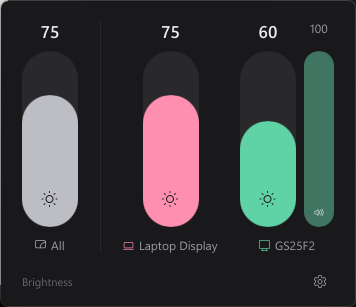
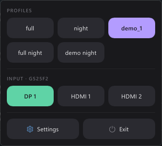
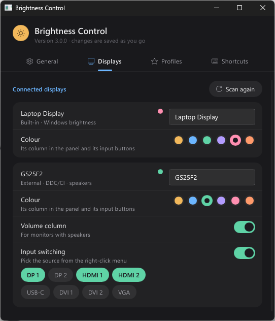

# Brightness Control


A small tray app for Windows that controls the brightness of **every screen you
have** — the laptop panel and external monitors — from one place. It also
handles monitor speakers, input switching (DP / HDMI / USB-C …), profiles and
global shortcuts. It sits quietly in the tray at about 10 MB of RAM.

<p align="center">
  
  &nbsp;&nbsp;
  
</p>

## Download

1. Grab **`BrightnessControl.exe`** from the
   [latest release](https://github.com/YasoDigo/BrightnessControl/releases/latest).
2. Put it in a folder it can stay in, e.g. `%LOCALAPPDATA%\Programs\BrightnessControl\`.
3. Run it. A sun icon appears in the tray.
4. Optional: *Settings → General → Start with Windows*.

It is a single portable file: no installer, no .NET, no Visual C++ runtime.
Windows SmartScreen may warn the first time because the file is not signed —
choose *More info → Run anyway*.

**Requirements:** Windows 10 or 11. For external monitors, **DDC/CI** must be
on in the monitor's own menu (it usually is).

## Using it

| Where | What it does |
|---|---|
| **Left-click** the tray icon | Opens the panel: one column per display, plus an *All* column when there are several. Drag, click or scroll a column. |
| **Right-click** the tray icon | Profiles, input source of each monitor, Settings, Exit. |
| **Mouse wheel** over the tray icon | Changes every display at once. |
| Columns | Snap to 10, 20, 30 … — hold **Ctrl** for exact values. Arrow keys, PgUp/PgDn, Home/End work too. |
| Shortcuts | Show the panel, open the menu, all displays up/down, each display up/down, each monitor's volume, apply a profile. Holding a key speeds up. |

### Settings

<p align="center"></p>

Four tabs, and every change is saved as you make it:

- **General** – theme (System / Dark / Light), start with Windows, snapping, tray-icon scrolling, log folder.
- **Displays** – rename a display, give it a colour, show a volume column, choose which inputs the menu offers.
- **Profiles** – save the current levels under a name; update, rename or delete them. Saving under an existing name asks before it overwrites.
- **Shortcuts** – click a key to record a combination (Esc cancels, Backspace removes). Combinations taken by another app are flagged.

### Command line

A second launch talks to the running instance:

```
BrightnessControl.exe              show the panel
BrightnessControl.exe --quick      open the right-click menu
BrightnessControl.exe --up|--down  all displays brighter / dimmer
BrightnessControl.exe --settings N open settings on tab N (0-3)
BrightnessControl.exe --tray       start silently (used for autostart)
```

Settings live in `%LOCALAPPDATA%\BrightnessControl\settings.toml`, daily logs
(kept for a week) in `%LOCALAPPDATA%\BrightnessControl\logs\`.

## How it works

- **Laptop panel** – through Windows' own brightness interface (WMI).
- **External monitors** – DDC/CI commands straight to the monitor (`dxva2`):
  brightness `0x10`, volume `0x62`, input source `0x60`.
- **One worker thread per monitor.** Commands never overlap on the cable, and
  only the latest value of a drag is sent ("last value wins"), with retries.
  A value read back from the monitor never makes a column jump back while you
  are still moving it.
- **Stable monitor identity** from the EDID (maker + serial), so names,
  colours, profiles and shortcuts stay with the right screen when cables or
  ports change.
- Rescans after a display change or waking from sleep; re-adds the tray icon if
  Explorer restarts.
- UI in [Slint](https://slint.dev) with the software renderer — no browser
  engine, no GPU process.

## Building from source

Needs Rust (stable, MSVC toolchain) on Windows.

```
cargo test --workspace
cargo build --release -p bc-app
```

The result is `target/release/BrightnessControl.exe`. The C runtime is linked
statically (see `.cargo/config.toml`), so the exe runs anywhere without extra
installs.

| Path | What |
|---|---|
| `crates/bc-core` | Everything that is not UI: discovery, DDC/CI, WMI, workers, settings, profiles, import of old settings. Unit tested. |
| `crates/bc-core/src/bin/bc-cli.rs` | Small command-line tool to list and set displays (handy for testing a monitor). |
| `crates/bc-app` | The tray app: Win32 shell thread (tray icon, hotkeys, system events) and the Slint windows in `ui/`. |

## License

[MIT](LICENSE)
